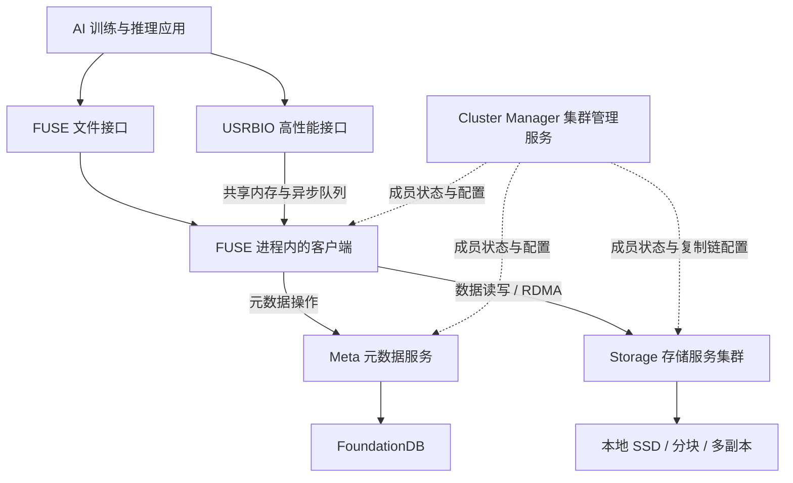

# 3FS 架构、优势与关键技术

## 概述

**3FS（Fire-Flyer File System）是 DeepSeek 面向 AI 训练和推理设计的高性能分布式文件系统。** 它通过高速网络汇聚多台服务器的 SSD，为计算集群提供共享存储。Storage 服务直接管理本地 SSD，文件元数据持久化到 FoundationDB。

## 主要优势

- **高吞吐、高并发**，支持训练样本随机读取、并行保存 Checkpoint 和推理 KV Cache。
- **存算分离**，计算节点共享数据，便于独立扩展计算与存储资源。
- **接入方便**，提供常用文件接口，可通过 FUSE 接入已有应用。
- **副本带宽利用率高**，多个副本共同承担读取请求。

以上定位与应用场景见[官方项目介绍](https://github.com/deepseek-ai/3FS)。

## 架构设计

3FS 由客户端、元数据服务、存储服务和集群管理服务组成，采用**元数据与数据访问路径分离**的设计。

| 组件 | 设计与职责 |
| --- | --- |
| **客户端** | FUSE 提供常用文件接口。USRBIO 通过共享内存和异步队列使用 FUSE 进程内的原生 I/O 能力 |
| **元数据服务 Meta** | 管理目录、文件属性和数据布局，自身无状态，元数据持久化到 FoundationDB |
| **存储服务 Storage** | 管理本地 SSD 上的数据块，通过 RDMA 传输数据，并维护复制链 |
| **集群管理服务 Cluster Manager** | 通过心跳跟踪服务状态，处理成员变化，维护并分发集群配置 |

### 典型读取流程

1. 客户端打开文件，向 Meta 获取文件的数据布局。
2. 客户端根据文件偏移计算 chunk 及其所属复制链。
3. 客户端直接向 Storage 发起数据读取，文件内容传输绕过 Meta。
4. 使用 USRBIO 时，应用通过共享请求队列批量提交异步 I/O，读取结果进入共享数据缓冲区。

架构与读写机制见[官方设计文档](https://github.com/deepseek-ai/3FS/blob/main/docs/design_notes.md)。

## 关键技术

| 技术 | 作用 |
| --- | --- |
| **全闪存与 RDMA** | 利用 SSD 并行能力，降低远程传输的 CPU 开销 |
| **分块与条带化** | 将文件分散到多条复制链，提高并行读写吞吐 |
| **基于 CRAQ 的链式复制** | 写入沿链传播，读取分摊到多个副本，通过版本与提交机制保证数据一致性 |
| **USRBIO 异步 I/O** | 使用共享内存、环形队列和批量请求，减少拷贝与请求处理开销 |
| **无状态元数据服务与 FoundationDB** | 通过事务管理目录和文件元数据，支持元数据服务横向扩展 |

USRBIO 的共享数据缓冲区称为 Iov，共享请求环形队列称为 Ior。应用需先注册文件描述符，再通过该接口执行读写。详见[USRBIO 接口文档](https://github.com/deepseek-ai/3FS/blob/main/src/lib/api/UsrbIo.md)。

## 多副本容量开销

若原始数据大小为 D，保存 N 个完整副本，则总数据占用约为 N × D，额外副本占用约为 (N − 1) × D。

| 副本数 | 1TB 数据总占用 | 额外存储开销 | 理论容量利用率 |
| --- | --- | --- | --- |
| 2 | 2TB | 100% | 50% |
| 3 | 3TB | 200% | 33.3% |
| 4 | 4TB | 300% | 25% |

三副本为示例配置。100TB 原始数据采用三副本时，数据本身约占 300TB，部署时还需为元数据、更新期间的临时版本和运维预留空间。多个副本同时提供容错与读取能力，也增加磁盘写入量和副本间网络流量。

## 一致性边界

数据块复制通过已提交与待提交版本协调读写。普通读取遇到待提交状态时会收到特殊状态码并重试，接口也提供 relaxed read。文件长度在活跃写入期间可能最终一致，close/fsync 会触发精确长度查询。FUSE 提供常用 POSIX 文件接口，部分文件系统语义存在限制。详见[官方设计文档](https://github.com/deepseek-ai/3FS/blob/main/docs/design_notes.md)。
